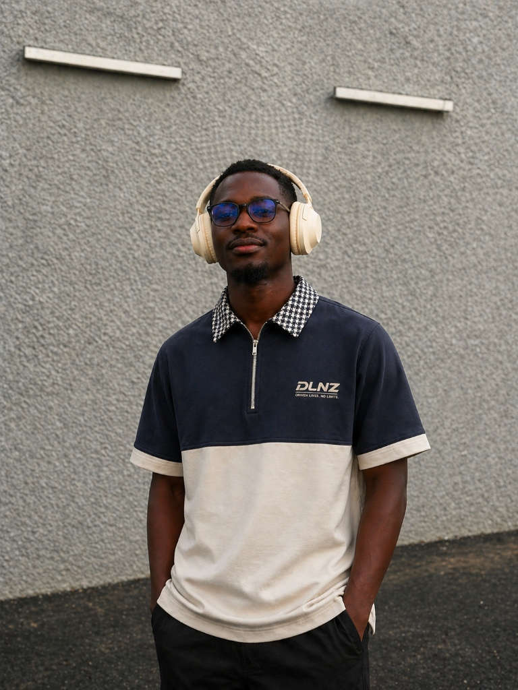

# COS 106 – Student Portfolio Website



A multi-page, responsive personal portfolio for **Abdulsamad Taiwo**, a Software Engineering student at MIVA Open University. It was built for the **COS 106 – Introduction to Web Technologies** Practical Term Project.

## 🚀 Live Demo
**[View Live Website Here](https://abdulsamadtaiwo648-dotcom.github.io/StudentPortFolio/)**
*(Note: Replace with your actual GitHub Pages link once deployed)*

---

## 📑 Page Structure

Every page shares a profile sidebar (photo, email, university, location, links) and a navigation bar.

### 1. 👤 About (`index.html`)
- Introduction and career goals.
- "What I'm doing" cards: backend development, REST APIs, CLI tools, web development.
- A personal voice introduction (`<audio>`).
- Interests.

### 2. 🎓 Resume (`resume.html`)
- Education timeline.
- Animated skill bars.

### 3. 💼 Projects (`projects.html`)
- DLNZ Store, SoloBiz, Digital Waste Management, CLI Tower Management System and Atlas OS.
- Category filter (All, Web, CLI, Tools), with a dropdown on small screens.
- Screenshots, with links to the live sites where they exist.

### 4. ✉️ Contact (`contact.html`)
- A contact form validated in the browser. Sending opens the visitor's email app with the message filled in.

---

## ✨ Interactive Features

- **3D background scene:** a particle shape drawn on a `<canvas>` with hand-written 3D projection (no libraries). Each page has its own shape: a globe, a helix, a lattice and a ring. Hovering a navigation link previews that page's shape.
- **3D card tilt:** project and service cards lean toward the pointer.
- **Motion preferences:** the scene and animations are turned off for visitors who prefer reduced motion.

---

## 🛠️ Technologies

- **HTML5:** semantic tags (`<main>`, `<aside>`, `<nav>`, `<article>`, `<section>`, `<figure>`), forms, lists and audio.
- **CSS:** custom properties, Flexbox, Grid, `@media` queries for phone, tablet and desktop, transitions and `@keyframes`.
- **JavaScript (vanilla):** DOM manipulation, event handling, form validation, project filtering, and Canvas 2D drawing for the 3D scene.

No build tools or frameworks are used.

| File | Purpose |
| --- | --- |
| `css/vcard.css` | Template layout and components (rethemed to blue) |
| `css/custom.css` | Site-specific additions |
| `js/vcard.js` | Sidebar toggle, project filter, form button state |
| `js/scene.js` | 3D scene, card tilt, skill bars, contact form email action |

---

## 🙏 Credits

The page layout and base styles are based on **[vCard – Personal portfolio](https://github.com/codewithsadee/vcard-personal-portfolio)** by **codewithsadee**, used under the MIT License. The full licence text is in [`THIRD_PARTY_LICENSES.md`](THIRD_PARTY_LICENSES.md).

Changes made to the template: content replaced, the single-page tabs split into separate pages, colours changed from gold to blue, the icon font replaced with inline SVG icons, and the testimonials, clients, blog and map sections removed.

The content, the 3D scene (`js/scene.js`) and the additions in `css/custom.css` are original work.

---

## 💻 Local Installation & Setup

1. Clone the repository:
   ```bash
   git clone https://github.com/abdulsamadtaiwo648-dotcom/StudentPortFolio.git
   ```
2. Navigate to the project directory:
   ```bash
   cd StudentPortFolio
   ```
3. Open `index.html` in any modern web browser.
   *(For the best development experience, you can use VS Code's "Live Server" extension).*

---

## 👨‍💻 Author
**Abdulsamad Taiwo**
- Programme: B.Sc. Software Engineering
- University: MIVA Open University
- GitHub: [@abdulsamadtaiwo648-dotcom](https://github.com/abdulsamadtaiwo648-dotcom)

*Built for COS 106 Term Project, 2025.*
